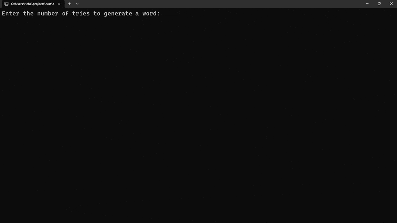

<summary align='center'>
    <h1>⚔️ Devil May Cry Combo Generator</h1>
</summary>


<br>
<br>

<summary>
    <h2>👀 Overview</h2>
</summary>

<p>
    This Rust program uses a context-free grammar (CFG) to generate random combat combos inspired by <i>Devil May Cry</i>. Each generated word is a sequence of Dante’s moves, read from left to right.
</p>

<p>
    Developed for Part 2 of Theory of Computation I (INF05005) at UFRGS, the grammar models both ground and aerial combat. Launches can nest to any depth, and every launch must have a matching descent before the combo ends.
</p>


<summary>
    <h2>🎬 Demo</h2>
</summary>




<summary>
    <h2>🚀 How to Run</h2>
</summary>

<h3>Download a release</h3>

<p>
    Open the <a href='https://github.com/Richard-Passos/computer-theory/releases/tag/v1.0.0'><code>Releases page</code></a>, expand <code>Assets</code>, and download the file for your platform.
</p>

<table>
    <thead>
        <tr>
            <th>Plataform</th>
            <th>Description</th>
        </tr>
    </thead>
    <tbody>
        <tr>
            <td><code>Windows (x64)</code></td>
            <td>Download the <code>.exe</code> file and run it from PowerShell.</td>
        </tr>
        <tr>
            <td><code>Linux (x64)</code></td>
            <td>Download the <code>linux-x64</code> archive and extract it.</td>
        </tr>
        <tr>
            <td><code>macOS</code></td>
            <td>Download the <code>macos-apple-silicon</code> or <code>macos-intel</code> archive for your Mac and extract it.</td>
        </tr>
    </tbody>
</table>

<h3>Run from source</h3>

<p>
    With Rust and Cargo installed, open a terminal in the folder containing <code>Cargo.toml</code> and run:
</p>

```sh
cargo run
```


<summary>
    <h2>📐 Grammar</h2>
</summary>

<p>
    Think of a combo as a list of moves that the generator fills in one step at a time. A <code>terminal</code> is a move that has already been chosen, such as <code>r</code> for a roll. A <code>nonterminal</code> is a placeholder for part of the combo that still needs to be generated.
</p>

```text
S → aS | rS | pS | lAS | lA | aaaa | e
A → e | aB | lAA
B → e | aC | lAA
C → e | aD | lAA
D → e | a  | lAA
```

<h3>Terminals</h3>

<table>
    <thead>
        <tr>
            <th>Symbol</th>
            <th>Move</th>
            <th>Effect</th>
        </tr>
    </thead>
    <tbody>
        <tr>
            <td><code>a</code></td>
            <td>Attack</td>
            <td>Dante strikes the opponent. One uninterrupted streak of four or more aerial attacks lowers him by exactly one level, even if he lands eight hits in a row.</td>
        </tr>
        <tr>
            <td><code>e</code></td>
            <td>Thrust</td>
            <td>In the air, Dante descends one level. On the ground, he ends the combo.</td>
        </tr>
        <tr>
            <td><code>l</code></td>
            <td>Launcher</td>
            <td>Dante launches himself and his opponent one level higher.</td>
        </tr>
        <tr>
            <td><code>r</code></td>
            <td>Roll</td>
            <td>Dante dodges while on the ground.</td>
        </tr>
        <tr>
            <td><code>p</code></td>
            <td>Taunt</td>
            <td>Dante taunts his opponent to build style while on the ground.</td>
        </tr>
    </tbody>
</table>

<h3>Nonterminals</h3>

<table>
    <thead>
        <tr>
            <th>Symbol</th>
            <th>Role in the grammar</th>
        </tr>
    </thead>
    <tbody>
        <tr>
            <td><code>S</code></td>
            <td>The start symbol. It generates a combo beginning on the ground.</td>
        </tr>
        <tr>
            <td><code>A</code></td>
            <td>Air with one attack</td>
            <td>Begin a one-level descent. Dante can descend immediately with e or start a four-hit streak with a.</td>
        </tr>
        <tr>
            <td><code>B</code></td>
            <td>Air with two attacks</td>
            <td>Continue the descent after one hit. Three more consecutive hits will lower Dante one level.</td>
        </tr>
        <tr>
            <td><code>C</code></td>
            <td>Air with three attacks</td>
            <td>Continue the descent after two hits. Two more consecutive hits will lower Dante one level.</td>
        </tr>
        <tr>
            <td><code>D</code></td>
            <td>Air with four attacks</td>
            <td>Complete the descent with one more a, the fourth hit in the streak.</td>
        </tr>
    </tbody>
</table>

> [!NOTE]
> Only `S` can produce a roll (`r`) or a taunt (`p`), as both moves require Dante to be on the ground.


<summary>
    <h2>📂 Repository Structure</h2>
</summary>

```text
├── src/
│   ├── dmc_grammar/...
│   ├── random_generator/...
│   ├── generator.rs
│   ├── grammar.rs
│   ├── main.rs
│   ├── production.rs
│   ├── symbol.rs
│   └── word.rs
└── README.md
```

<ul>
    <li>
        <a href='src/dmv_grammar'><code>dmc_grammar/...</code></a>: Implements the Devil May Cry inspired grammar using the grammar trait.
    </li>
    <li>
        <a href='src/random_generator'><code>random_generator/...</code></a>: Implements the Random Word Generator using the generator trait.
    </li>
    <li>
        <a href='src/generator.rs'><code>generator.rs</code></a>: Defines the word generator trait.
    </li>
    <li>
        <a href='src/grammar.rs'><code>grammar.rs</code></a>: Defines the grammar trait.
    </li>
    <li>
        <a href='src/main.rs'><code>main.rs</code></a>: Sets up the grammar and generator, runs the requested number of attempts, and prints the results.
    </li>
    <li>
        <a href='src/production.rs'><code>production.rs</code></a>: Stores the sequence of symbols that a grammar requires.
    </li>
    <li>
        <a href='src/symbol.rs'><code>symbol.rs</code></a>: Represents terminal and nonterminal symbols.
    </li>
    <li>
        <a href='src/word.rs'><code>word.rs</code></a>: The actual word model with its content.
    </li>
</ul>


<summary>
    <h2>✨ Features</h2>
</summary>

<ul>
    <li>
        <code>Random generation.</code> The generator starts at <code>S</code> nonterminal symbol and randomly chooses a production for each nonterminal until only terminals remain.
    </li>
    <li>
        <code>Word length limit.</code> The generator stops and prints a message when a word reaches its maximum length, so the word cannot grow indefinitely.
    </li>
    <li>
        <code>Configurable attempt count.</code> Choose how many generation attempts to run in one session and read the results in the terminal.
    </li>
    <li>
        <code>Replaceable grammar.</code> The generator uses the <code>Grammar</code> trait, so another grammar can supply its own productions.
    </li>
</ul>
